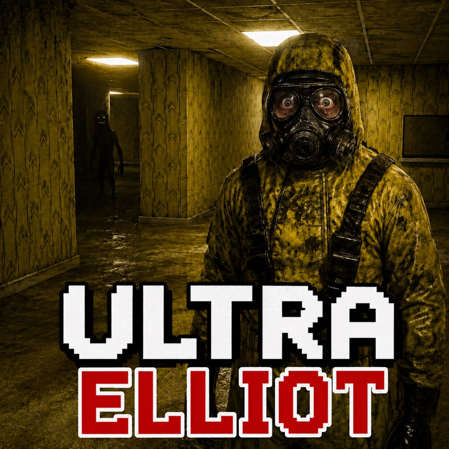

# Ultra Elliot

A backrooms-style horror maze that runs entirely in the browser. No build step,
no dependencies — three files and a cover image.



## Files

- `index.html` — game page
- `style.css` — page styling
- `game.js` — engine and game logic
- `public/Ultra-Elliot-cover.jpg` — cover art (title screen, social preview)
- `public/Ultra-Elliot-icon.png` — favicon and header mark
- `public/Ultra-Elliot.png` — full-resolution original (kept locally, not deployed)
- `public/sound/` — the adaptive score (`explore-*` and `danger-*` decks)
- `public/sound/source/` — full-quality originals, kept out of the deploy
- `README_SWITCH_READY.md` — platform readiness, controller mapping, and what a
  Nintendo Switch OLED port would actually require
- `port/` — engine-agnostic export of the whole game as data, plus a porting
  guide. Run `node port/export-data.js` to regenerate, `node port/validate-data.js`
  to verify.

## Play

### Local server (recommended)

The title screen loads the cover art, so the page needs to be served rather than
opened from disk:

```
python3 -m http.server 8000
```

Then open <http://localhost:8000>.

### Live Server in VS Code

1. Open this folder in Visual Studio Code.
2. Install the **Live Server** extension by Ritwick Dey.
3. Right-click `index.html` → **Open with Live Server**.

Opening `index.html` directly with a `file://` URL also works, but some browsers
block the cover image that way.

## Controls

All input goes through one abstraction layer, so keyboard, mouse, gamepad and
touch drive the same code. See [README_SWITCH_READY.md](README_SWITCH_READY.md).

| Action | Keyboard | Gamepad | Touch |
| --- | --- | --- | --- |
| Move | W/S, Arrow Up/Down | Left Stick, D-pad | On-screen pad |
| Strafe | A / D | Left Stick | ◀ / ▶ |
| Look / turn | Mouse, Arrow Left/Right, **Q / E** | Right Stick | Drag on screen |
| Run | Shift | Left Stick Click | RUN |
| Torch | F | Top face button | TORCH |
| Confirm / restart | Enter | Bottom face button | Tap screen |
| Pause | Escape, P | Start / Menu | ❚❚ |
| Back | Escape | Right face button | — |
| Music on/off | M | — | ♪ button |
| Bloom on/off | B | — | — |

Click the game to capture the mouse for looking; press Escape to release it.
Gamepad and touch players never need pointer lock.

`A`/`D` strafe. Turning is on the arrow keys and on `Q`/`E`, so the game is
fully playable on a keyboard alone, with or without a mouse.

Two controllers are detected and tracked as separate players. Co-op is not
playable yet — see the two-player section of
[README_SWITCH_READY.md](README_SWITCH_READY.md) for exactly what remains.

## Soundtrack

An **adaptive two-deck score** in `public/sound/`. One deck is always audible;
the other sits silent and parked. Detection crossfades between them.

| Deck | Tracks | Plays when |
| --- | --- | --- |
| `explore-*` | Claustrophobic Drone I *(Elliot's favourite, leads)*, Fluorescent Shadows I & II, Claustrophobic Drone II | Title screen and normal exploration |
| `danger-*` | Creature Hunt I & II, Pounding Heartbeat | A creature has actually seen you |

- Each deck **rotates its own playlist** independently.
- The danger deck **holds for 4.5 s after line of sight breaks**, so the score
  cannot flap as a creature ducks behind a corner.
- The danger deck is **not downloaded on the title screen** — it loads only
  once you enter the maze.
- A faded-out deck is paused rather than left streaming.
- A **menu pause ducks** the score to 0.12 and keeps it running; a **system
  suspend** (hidden tab, lost focus, controller disconnect) stops it dead.
- `M` or the ♪ button mutes both decks; remembered per browser.
- A missing or unplayable file skips within its own deck.

Browsers block audio until the player interacts, so the score starts on the
click or tap that enters the game. That is intended, not a bug.

### Adding tracks

Drop an `.mp3` into `public/sound/` named `explore-NN-*` or `danger-NN-*`, then
add it to the matching deck in `Music.decks` in [game.js](game.js).

Originals live in `public/sound/source/` and are kept out of the deploy. The
served files are re-encoded to 112 kbps, which took the audio from 12 MB to
7.4 MB with no audible loss on ambient material.

## Game

- 10 connected levels: Yellow Lobby, Office Maze, Parking Garage, Electrical
  Station, Poolrooms, Pipe Tunnels, The Hub, Red Rooms, Carpet Halls and the
  Endless Exit Signs
- 21 creatures across 12 silhouettes
- 7 access cards, 3 lives
- One true exit hidden among 14 lying EXIT signs
- No jump scares

### The flashlight

The torch is the whole game. It drains while it is on and recovers while it is
off, so you are always trading visibility against the risk of being caught in
the dark. Lit creatures also notice you from further away — running with the
light on is the fastest way to get found.

Ambient light varies per level. The Yellow Lobby is bright enough to cross
without the torch; the Electrical Station and the Endless Exit Signs are not.

## Engine notes

- **16:9 everywhere.** Five internal resolution tiers, each an exact 16:9
  multiple, from 1920x1080 down to 640x360. Boots at 1280x720.
- **Dynamic resolution.** On *Auto*, frame time is sampled continuously; the
  tier drops above 20 ms and climbs below 7.5 ms, with a cooldown so it cannot
  oscillate.
- **Quality selector.** The dropdown beside Pause/Restart pins any tier —
  including 1080p — which switches dynamic scaling off and overrides the
  heuristic. The choice is remembered per browser.
- **Responsive.** The stage holds 16:9 on every screen tested, from a 360 px
  phone to a 1440 px desktop, with no cropping and no horizontal scroll.
  Landscape phones overlay the touch pads on the stage instead of stacking
  below it.
- Textured raycaster (DDA); wall column count follows the render tier.
- Floors and ceilings are cast per pixel into a half-resolution buffer.
- Flashlight is a real cone with horizontal and vertical falloff.
- Post-processing: bloom, chromatic fringing, scanlines, film grain, and a
  vignette that tightens when something is hunting you.
- A paused frame is re-presented from cache rather than re-rendered.

Frame cost with GPU acceleration **disabled** (worst case; a real browser is
several times faster):

| Tier | Frame time |
| --- | --- |
| 1024x576 | ~14 ms |
| 1280x720 | ~21 ms |
| 640x360 | ~5 ms |
